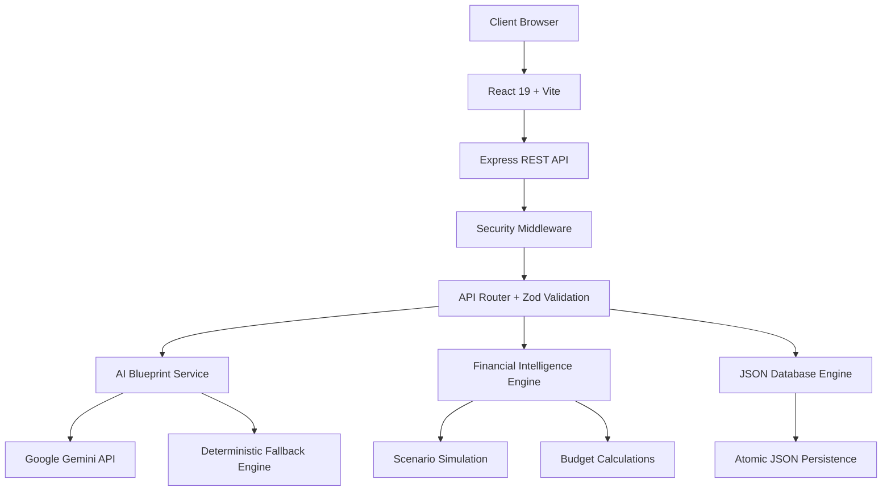

# 🏛️ Celebration Atelier
### Luxury Event Planning & Predictive Fiscal Intelligence Platform

**Celebration Atelier** is an AI-powered event planning and financial intelligence platform designed to simplify the planning, budgeting, and operational management of luxury destination weddings, milestone celebrations, and large-scale cultural festivals.

Combining generative AI, predictive financial modeling, and a security-focused application architecture, the platform transforms event planning into a structured, data-driven experience.

Built using **React 19, TypeScript, Node.js, Express, Google Gemini, and Vite**, Celebration Atelier brings creative event design and financial decision-making together in one unified workspace.

---

## ✨ Key Features

### 🤖 1. AI-Powered Master Blueprint Studio

Generate comprehensive event planning blueprints using Google Gemini.

- AI-generated multi-day event itineraries.
- Context-aware recommendations based on celebration types.
- Customizable event themes and creative direction.
- Curated color palettes with hexadecimal color codes.
- Venue layout and spatial planning recommendations.
- Culinary concepts and VIP experience suggestions.
- Automated milestone checklists.
- Deterministic fallback engine for operation without an AI API key.

**Supported Celebration Archetypes:**
- Royal Weddings
- Milestone Birthdays
- Community Galas
- Cultural Festivals

### 📊 2. Predictive Financial Intelligence

A financial planning engine designed to help event organizers make informed budgeting decisions.

- Real-time budget tracking.
- Committed expenditure monitoring.
- Guest-count sensitivity analysis.
- Decoration tier comparison (Classic, Couture, Regal).
- Beverage package scenario modeling.
- Marginal cost-per-guest calculations.
- Contingency budget monitoring.
- Financial variance calculations.
- Indian currency formatting using ₹ and Lakhs/Crores notation.

### 🎨 3. Premium Event Management Experience

A minimalist editorial interface focused on clarity, usability, and professional presentation.

- Clean and responsive dashboard.
- Architectural sidebar navigation.
- Financial telemetry and operational readiness indicators.
- Celebration configuration workflows.
- Interactive budget and planning interfaces.
- Consistent design system with reusable components.
- Smooth animations and reduced-motion support.

### 🔐 4. Security & Authentication

Security is integrated throughout the application using a defense-in-depth approach.

- Password hashing using Node.js `scrypt`.
- Random cryptographic salts.
- HMAC-SHA256 signed session tokens.
- Unique JWT-style token identifiers (`jti`).
- Token revocation through a centralized denylist.
- Automatic account lockout after five consecutive failed login attempts.
- Fifteen-minute lockout duration.
- Strict Zod request validation.
- Mass-assignment protection using strict schemas.
- HTTP security headers and Content Security Policy.
- HSTS and clickjacking protection.
- Anti-prototype-pollution middleware.
- Sensitive information redaction in audit logs.
- Automatic client-side token refresh and authentication recovery.

### ♿ 5. Accessibility & Inclusive Design

Designed with accessibility considerations aligned with **WCAG 2.2 AA**.

- Keyboard-accessible navigation.
- Circular modal focus trapping.
- Escape-key modal dismissal.
- Automatic focus restoration.
- Screen-reader-friendly data tables.
- Semantic form labels and controls.
- Accessible live announcements.
- Reduced-motion preferences.
- Accessible representations of complex visualizations.

---

## 🏗️ System Architecture

Celebration Atelier follows a modular client-server architecture.



### Architecture Components

| Component | Responsibility |
|---|---|
| React Frontend | User interface and event planning workflows |
| Vite | Development server and production bundling |
| Express Backend | REST API and application logic |
| Security Middleware | Authentication, rate limiting, and HTTP protection |
| Zod Validation | Strict request validation |
| AI Service | Blueprint generation and AI integration |
| Financial Engine | Budget calculations and scenario simulations |
| JSON Database | Persistent data storage with atomic writes |

---

## 🛠️ Technology Stack

| Category | Technologies |
|---|---|
| Frontend | React 19, TypeScript 5.8 |
| Styling | Vanilla CSS, Tailwind CSS v4 |
| Icons | Material Symbols, Lucide |
| Animations | Motion |
| Build Tool | Vite |
| Backend | Node.js v22, Express 4.x |
| AI Integration | Google Gemini |
| Validation | Zod 4.x |
| Database | Atomic JSON Persistence |
| Authentication | Scrypt, HMAC-SHA256 |
| Testing | Vitest, JSDOM, Axe-Core |
| CI/CD | GitHub Actions |
| Version Control | Git, GitHub |

---

## 🚀 Getting Started

Follow these instructions to run Celebration Atelier locally.

### Prerequisites

Make sure the following tools are installed:

- Node.js >= 20.x (Node.js v22 recommended)
- npm >= 10.x
- Git

### 1. Clone the Repository

```bash
git clone https://github.com/Rutuja-131005/Celebration-Event-Planner.git

cd Celebration-Event-Planner
```

### 2. Install Dependencies

```bash
npm install
```

### 3. Configure Environment Variables

Create a `.env` file using the example configuration:

```bash
cp .env.example .env
```

Add your Google Gemini API key if you want to enable AI-powered blueprint generation:

```env
GEMINI_API_KEY=your_gemini_api_key
```

**Note:** The platform includes a deterministic fallback synthesis engine, allowing blueprint generation without a configured Gemini API key.

Never commit your actual API keys or secrets to GitHub.

### 4. Start the Development Server

```bash
npm run dev
```

Open your browser and navigate to:

```text
http://localhost:3000
```

### 5. Build for Production

```bash
npm run build
```

### 6. Start the Production Server

```bash
npm start
```

---

## 🧪 Testing & Quality Assurance

The project includes automated testing, security checks, accessibility validation, and performance benchmarking.

| Command | Description |
|---|---|
| `npm run lint` | TypeScript static analysis |
| `npm test` | Execute automated test suites |
| `npm run test:coverage` | Generate test coverage reports |
| `npm run bench` | Run performance benchmarks |
| `npm run build` | Generate production bundles |
| `npm audit` | Check dependencies for known vulnerabilities |

### Verification Results

According to the project's documented verification results:

- 20 backend test suites.
- 67 backend assertions.
- 30 frontend Vitest suites.
- Zero TypeScript compilation errors.
- Zero reported dependency vulnerabilities at the time of the documented audit.
- Production bundle optimization with a reported 24.4% main-chunk reduction.

Performance benchmarks were conducted using Node.js v22.

| Benchmark | Reported Throughput |
|---|---:|
| Budget Metrics Calculation | 112,730 ops/sec |
| Scenario Sensitivity Simulation | 109,718 ops/sec |
| Zod Payload Validation | 119,074 ops/sec |
| HMAC-SHA256 Token Verification | 26,301 ops/sec |
| Input Sanitization | 833,076 ops/sec |

*Benchmark figures are environment-dependent and should be interpreted according to the documented benchmark methodology.*

---

## 📁 Project Structure

```text
Celebration-Event-Planner/
│
├── .github/
│   └── workflows/              # GitHub Actions CI/CD
│
├── data/
│   └── atelier_db.json         # JSON database persistence
│
├── docs/
│   ├── ACCESSIBILITY.md        # Accessibility documentation
│   └── PERFORMANCE.md          # Performance benchmarks
│
├── scripts/
│   └── benchmark.ts            # Benchmark scripts
│
├── server/
│   ├── api/
│   │   └── routes.ts           # REST API routes
│   │
│   ├── config/
│   │   └── constants.ts        # Application constants
│   │
│   ├── db/
│   │   └── database.ts         # Atomic JSON database engine
│   │
│   ├── models/
│   │   └── types.ts            # Backend type definitions
│   │
│   ├── services/               # AI and financial services
│   ├── tests/                  # Backend test suites
│   │
│   ├── utils/
│   │   └── security.ts         # Authentication utilities
│   │
│   └── validation/
│       └── schemas.ts          # Zod validation schemas
│
├── src/
│   ├── components/             # Reusable UI components
│   ├── pages/                  # Application pages
│   ├── services/               # Frontend API services
│   ├── tests/                  # Frontend tests
│   ├── App.tsx                 # Root application
│   ├── index.css               # Design system
│   └── main.tsx                # Application entry point
│
├── ARCHITECTURE.md             # System architecture
├── SECURITY.md                 # Security documentation
├── SCORECARD.md                # Project audit scorecard
├── LICENSE                     # MIT License
├── package.json
├── tsconfig.json
└── vite.config.ts
```

---

## 🔒 Security Considerations

Security is a core design consideration of Celebration Atelier.

The project incorporates authentication controls, strict input validation, token management, secure HTTP headers, and audit logging.

For security-related information, vulnerability reporting, and responsible disclosure guidelines, refer to:

- [Security Policy](SECURITY.md)
- [Accessibility Documentation](docs/ACCESSIBILITY.md)
- [Performance Documentation](docs/PERFORMANCE.md)

**Important:** The current application uses JSON-based persistence and an in-memory token revocation mechanism. These are suitable architectural choices for a prototype or controlled deployment, but production deployment with multiple server instances requires durable shared storage, persistent revocation, and additional operational security controls.

---

## 🗺️ Future Enhancements

Potential directions for further development include:

- Integration with venue and vendor management systems.
- Real-time collaborative event planning.
- Advanced financial forecasting and optimization.
- Historical event expenditure analytics.
- Exportable event budgets and planning reports.
- Cloud-based persistent database integration.
- Multi-user role-based access control.
- Enhanced AI-driven recommendations.
- Integration with payment and booking platforms.

---

## 🤝 Contributing

Contributions, suggestions, and improvements are welcome.

1. Fork this repository.
2. Create a feature branch.
3. Implement your changes.
4. Run the available tests.
5. Submit a pull request with a clear description.

Please ensure that contributions follow the existing coding standards and security practices.

---

## 📄 License

This project is distributed under the **MIT License**.

See the [LICENSE](LICENSE) file for more information.

---

### 🏛️ Celebration Atelier

**Where Creative Celebrations Meet Intelligent Financial Planning.**

*Designed with creativity. Engineered with intelligence.*
