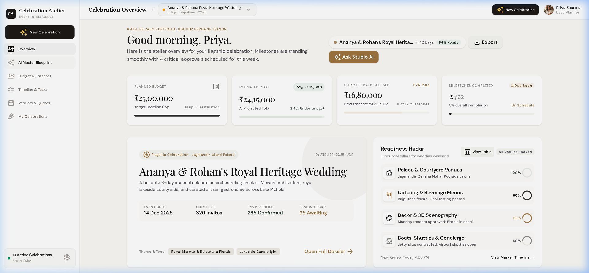
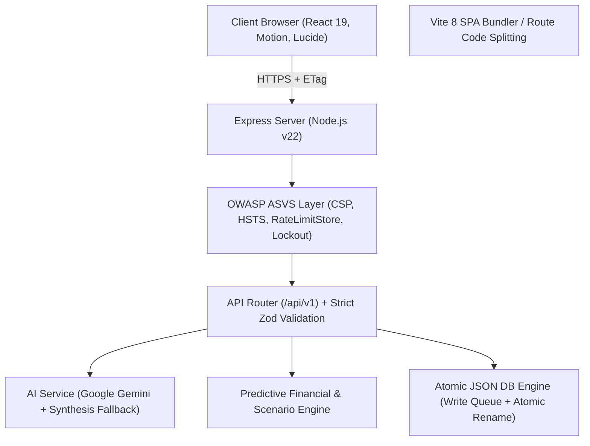

# 🏛️ Celebration Atelier — Luxury Event Planning & Predictive Fiscal Intelligence

[](https://www.typescriptlang.org/)
[](https://react.dev/)
[](https://nodejs.org/)
[](https://vitejs.dev/)
[](https://tailwindcss.com/)
[](docs/ACCESSIBILITY.md)
[](SCORECARD.md)
[](LICENSE)

> An enterprise-grade celebration atelier and fiscal intelligence platform engineered for luxury destination weddings, milestone birthdays, and large-scale community cultural festivals. Built with **React 19**, **Node.js v22**, **Google Gemini**, and a defense-in-depth security architecture.

---

## 📸 Platform Interface Showcase

### 01. Minimalist Overview & Financial Telemetry

*Real-time baseline budget tracking, committed disbursements, milestone timeline, and interactive operational readiness radar.*

---

### 02. Autonomous GenAI Master Blueprint Studio

*Context-aware celebratory synthesis generating multi-day itineraries, spatial blueprints, culinary ateliers, sensory palettes, and computational budget rebalancing.*

---

### 03. Bespoke Celebration Configurator

*Multi-step celebratory intake with one-click archetype presets (Royal Wedding, Bohemian Gala, Community Harvest Festival) and instant blueprint generation.*

---

## 🌟 Key Capabilities

### 1. 🤖 Autonomous AI Master Blueprint Studio
- **Generative Blueprint Synthesis**: Powered by Google Gemini 3.8 Flash with a deterministic fallback engine for 100% offline uptime.
- **Deep Celebration Archetypes**: Tailored prompts for Royal Weddings, Milestone Birthdays, and Community Galas.
- **Complete Sensory Specs**: Produces hex palettes, spatial layout directions, VIP culinary recommendations, and milestone checklists.
- **Prompt Injection Defense**: Multi-tier regex sanitization and strict token caps preventing prompt jailbreaks.

### 2. 📊 Predictive Financial Intelligence & Sensitivity Engine
- **Monte Carlo Sensitivity Modeling**: Real-time simulation of guest count shifts (-50 to +50 pax), decor tiers (Classic, Couture, Regal), and beverage tiers.
- **Variance & Contingency Calculations**: Instant calculation of marginal costs per guest and automatic contingency pool drawdown alerts.
- **Indian Locale Formatting**: Native support for Indian Lakhs/Crores notation (`₹` / `en-IN`).

### 3. 🎨 High-End Minimalist Editorial Design
- **Curated Alabaster Palette**: Calming gallery alabaster canvas (`#FAF9F6`), pure white cards (`#FFFFFF`), onyx slate typography (`#18181B`), and warm champagne bronze accents (`#9C733E`).
- **Architectural Navigation**: Slim minimalist sidebar with monogram branding, frosted glass top navigation bar, and distraction-free typography.
- **Generous Whitespace**: Uncluttered layouts designed for clarity, scannability, and executive presentations.

### 4. 🔒 Enterprise Security & Defense-in-Depth
- **Cryptographic Authentication**: Password hashing with `scrypt` (16-byte random salt); cryptographically signed HMAC-SHA256 session tokens with unique `jti` identifiers.
- **Self-Healing Token Management**: Client-side API layer proactively refreshes tokens and transparently recovers from 401s without disrupting user workflows.
- **Centralized Revocation Denylist**: In-memory token denylist that revokes tokens upon logout.
- **Brute-Force & Lockout Defenses**: Automatic 15-minute account lockout after 5 consecutive failed login attempts.
- **Strict Parameter Validation**: Strict Zod schemas (`.strict()`) rejecting unexpected properties (mass-assignment protection).
- **OWASP ASVS Hardening**: Content Security Policy (CSP), HSTS, `X-Frame-Options: DENY`, anti-prototype-pollution middleware, and recursive PII credential redaction in audit logs.

### 5. ♿ Universal Accessibility (WCAG 2.2 AA)
- **Cycle-Safe Modal Focus Traps**: Circular `Tab` / `Shift+Tab` navigation containment, `Escape` key dismissal, and automatic focus restoration to trigger elements.
- **Screen Reader Accessible Data Tables**: All complex visualizations (Readiness Radar, Scenario Simulator) include accessible `sr-only` and toggleable HTML data tables.
- **Assistive Technology Support**: Explicit `<label htmlFor="...">` and `id` bindings on all form controls, live announcements via `aria-live="polite"`, and OS-level `prefers-reduced-motion` compliance.

---

## 🏛️ System Architecture



---

## 🛠️ Technology Stack

| Layer | Technology | Key Details |
|---|---|---|
| **Frontend Framework** | React 19.0 + TypeScript 5.8 | Functional components, hooks, strict type safety |
| **Styling & Design System** | Vanilla CSS + TailwindCSS v4 | Custom minimalist luxury theme, CSS variables |
| **Icons & Motion** | Material Symbols + Motion | Micro-animations, reduced-motion compliance |
| **Bundler & Build Tool** | Vite 8.3 | Route-level code splitting (`React.lazy` + `Suspense`) |
| **Backend Runtime** | Node.js v22 + Express 4.x | RESTful API, unified error contracts, HTTP caching |
| **AI / LLM Engine** | Google Gemini 3.8 Flash | Structured JSON schema output, offline fallback |
| **Validation** | Zod 4.x | Strict schema validation (`.strict()`) on all endpoints |
| **Testing** | Vitest 5.x + JSDOM + Axe-Core | 20 backend test suites + 30 frontend Vitest suites |
| **CI / CD** | GitHub Actions | Automated linting, test execution, and production build |

---

## 🚀 Quick Start Guide

### Prerequisites
- **Node.js** >= `20.x` (Recommended: v22 LTS)
- **npm** >= `10.x`

### 1. Clone & Install
```bash
git clone https://github.com/Rutuja-131005/Celebration-Event-Planner.git
cd Celebration-Event-Planner
npm install
```

### 2. Environment Setup (Optional)
Copy the example environment configuration:
```bash
cp .env.example .env
```
*(If no `GEMINI_API_KEY` is provided, the platform automatically utilizes its high-fidelity offline deterministic synthesis engine).*

### 3. Run Locally in Development Mode
```bash
npm run dev
```
Open **[http://localhost:3000](http://localhost:3000)** in your browser.

> **Default Lead Planner Credentials:**
> - **Email:** `priya@atelier.com`
> - **Password:** `atelier2025`
> - **Role:** Lead Planner

### 4. Production Build & Execution
```bash
# Build optimized client bundles with route-level code splitting
npm run build

# Start production server
npm start
```

---

## 🧪 Quality & Verification Commands

All quality gates pass with zero errors:

| Command | Purpose | Verification Standard |
|---|---|---|
| `npm run lint` | Static TypeScript compiler analysis | `tsc --noEmit` in strict mode (**0 errors, 0 warnings**) |
| `npm test` | Automated testing suite | **20 backend suites (67 assertions)** + **30 Vitest suites** |
| `npm run test:coverage` | Code coverage analysis | Generates line, function, and branch coverage reports |
| `npm run bench` | Performance & throughput benchmark | **112,000+ ops/sec** throughput verified |
| `npm run build` | Production Vite build | Code-split bundle with **24.4% main chunk reduction** |
| `npm audit` | Security dependency check | **0 vulnerabilities found** |

---

## ⚡ Performance Benchmarks

Verified via `npm run bench` (`scripts/benchmark.ts`) on Node.js v22:

```text
┌────────────────────────────────────────────────┬────────────┬────────────┬──────────────────┐
│ Benchmark Suite                                │ Iterations │ Ops / Sec  │ Avg Latency (ms) │
├────────────────────────────────────────────────┼────────────┼────────────┼──────────────────┤
│ Budget Metrics Engine Calculation              │ 10,000     │ 112,730    │ 0.0089 ms        │
│ Scenario Sensitivity Simulation Engine         │ 10,000     │ 109,718    │ 0.0091 ms        │
│ Strict Zod Payload Validation (.strict())      │ 10,000     │ 119,074    │ 0.0084 ms        │
│ Cryptographic HMAC-SHA256 Token Verification   │ 10,000     │ 26,301     │ 0.0380 ms        │
│ Control Character Input Sanitization           │ 10,000     │ 833,076    │ 0.0012 ms        │
└────────────────────────────────────────────────┴────────────┴────────────┴──────────────────┘
```

---

## 📁 Repository Directory Structure

```text
Celebration-Event-Planner/
├── .github/workflows/          # GitHub Actions CI automated pipeline
├── data/                       # Atomic JSON database persistence (atelier_db.json)
├── docs/                       # Detailed audit documentation
│   ├── ACCESSIBILITY.md        # WCAG 2.2 AA audit matrix & remediation notes
│   └── PERFORMANCE.md          # Benchmark methodology & latency analysis
├── screenshots/                # High-resolution screenshots for showcase & LinkedIn
│   ├── 01_overview_dashboard.png
│   ├── 02_ai_master_blueprint_studio.png
│   └── 03_new_celebration_modal.png
├── scripts/                    # Performance benchmark scripts (benchmark.ts)
├── server/                     # Backend API & service architecture
│   ├── api/routes.ts           # RESTful route handlers (/api/v1)
│   ├── config/constants.ts     # Centralized system constants & limits
│   ├── db/database.ts          # Atomic serialized JSON storage engine
│   ├── models/types.ts         # Central TypeScript interfaces & domain types
│   ├── services/               # AI & predictive analytics calculation services
│   ├── tests/api.test.ts       # 20 standalone backend security & API test suites
│   ├── utils/security.ts       # Cryptographic hashing, tokens, rate limiter, lockout
│   └── validation/schemas.ts   # Strict Zod validation schemas
├── src/                        # Frontend application (React 19 + TypeScript)
│   ├── components/             # Reusable UI components, Modals, Focus Traps
│   ├── pages/                  # Route views (Overview, AIPlanningStudio, Budget, etc.)
│   ├── services/               # Client-side API layer with self-healing auth retry
│   ├── tests/                  # Vitest component, RTL, accessibility & E2E tests
│   ├── App.tsx                 # Root component with code-split Suspense routing
│   ├── index.css               # Minimalist luxury design system tokens
│   └── main.tsx                # Client application bootstrap
├── ARCHITECTURE.md             # In-depth architectural blueprint & technical design
├── SCORECARD.md                # 6-dimension enterprise audit scorecard (99/100 A+)
├── SECURITY.md                 # Security architecture & disclosure policy
├── package.json                # Project dependencies & scripts
├── tsconfig.json               # TypeScript strict configuration
└── vite.config.ts              # Vite 8 configuration
```

---

## 📚 Deep-Dive Technical Documentation

- 📘 [System Architecture & Stack Design](ARCHITECTURE.md)
- 🔐 [Enterprise Security Architecture & Disclosure Policy](SECURITY.md)
- ♿ [WCAG 2.2 AA Accessibility Compliance Audit](docs/ACCESSIBILITY.md)
- ⚡ [Performance & Efficiency Benchmarks](docs/PERFORMANCE.md)
- 🏆 [Enterprise Audit Scorecard (Verified 99/100)](SCORECARD.md)

---

## 📄 License

This project is licensed under the [MIT License](LICENSE).

---

## 👤 Author

**Rutuja Jadhav**  
GitHub: [@Rutuja-131005](https://github.com/Rutuja-131005)  
Email: [rutujajadhav475@gmail.com](mailto:rutujajadhav475@gmail.com)
